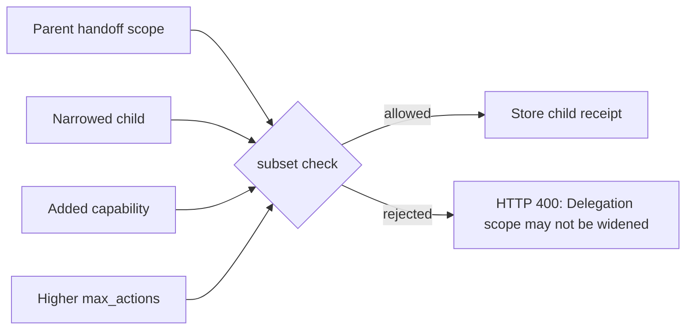

# scope-escalation-demo

A tiny repository that shows one AgentGrid rule end to end: **a child handoff
may only narrow the scope it inherits**. It is an exploit-to-fix demo: the
"exploit" is trying to add a capability or raise `max_actions`; the fix is the
same subset check used by the hosted API.

## Two modes

| Mode | What it runs | Requirements |
|---|---|---|
| Local | `scope_chain.py` mirrors the service check; prints ACCEPT/REJECT for five cases | Python 3.10+ only |
| Live | `live_demo.py` creates real agents, accepts one narrowed child handoff, and shows the API rejecting two widened ones | `pip install theoc-agentgrid-protocol` and your own `AGENTGRID_API_KEY` |

Local mode proves the rule. Live mode proves the hosted service enforces it.

## Run locally

```bash
python scope_chain.py
python -m unittest discover -s tests
```

Expected shape:

```text
Parent scope: {'allowed': ['read'], 'max_actions': 2}
----------------------------------------------------------
ACCEPT  narrow both fields      child={'allowed': ['read'], 'max_actions': 1}  [ok]
ACCEPT  same scope              child={'allowed': ['read'], 'max_actions': 2}  [ok]
ACCEPT  extra non-enforced key  child={'allowed': ['read'], 'max_actions': 2, 'note': 'ok'}  [ok]
REJECT  add write capability    child={'allowed': ['read', 'write'], 'max_actions': 2}  [ok]
REJECT  raise max_actions       child={'allowed': ['read'], 'max_actions': 5}  [ok]
----------------------------------------------------------
Local check passed. Live mode proves the hosted API rejects the same widened cases.
```

The rule mirrors the service exactly for the enforced keys:

- If `allowed` appears in the child, it must also appear in the parent, and the
  child list must be a subset.
- If `max_actions` appears in the child, it must also appear in the parent, and
  the child value may not be higher.
- Other scope keys are signed and stored verbatim, but are not used by this
  check. This demo does not claim they are enforced.



## Run live (optional)

```bash
pip install theoc-agentgrid-protocol
export AGENTGRID_API_KEY=agk_...      # your own key, in your own environment
python live_demo.py
```

Windows CMD: `set AGENTGRID_API_KEY=agk_...`

The script creates three agents and one accepted handoff on your own account.
It then sends two signed child handoffs with widened scopes; the service rejects
them with HTTP 400 before storing a receipt. Failed handoffs are not written.
The API key is never printed and is not stored by this repo.

## Honest notes

- This is not a vulnerability disclosure. It demonstrates an existing validation
  rule, not a bypass.
- The local file is a model of the check; the live script is the proof against
  the deployed API.
- No API keys, admin keys, payment details, or personal data are included.

Service: https://agentgrid-pied.vercel.app ·
Guide: https://agentgrid-pied.vercel.app/guide#scope-design
