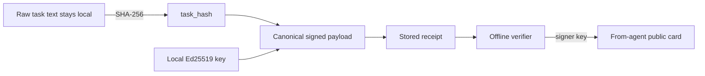

# task-binding-receipt-demo

A small repository that shows how an AgentGrid receipt binds a task without
storing the raw task text. The signed handoff carries `task_hash`, a SHA-256
digest. Change the task and the digest changes; change the digest and the
signature no longer verifies.

This is **not** raw context replay. Receipts contain a hash, a scope, IDs, and a
timestamp — not the original prompt or document.

## Two modes

| Mode | What it runs | Requirements |
|---|---|---|
| Local | Signs a canonical payload, then tampers with `task_hash` to break verification | Python 3.10+ and `cryptography` |
| Live | Records a real handoff, reads the public receipt, compares the signer key to the from-agent card, and verifies the signature locally | `pip install theoc-agentgrid-protocol` and your own `AGENTGRID_API_KEY` |

## Run locally

```bash
pip install cryptography
python task_binding.py
python -m unittest discover -s tests
```

Expected shape:

```text
Task (local only):   summarize the quarterly report
Stored task_hash:    d7478bf2...
Signed fields:       created_at, from_agent_id, handoff_id, parent_handoff_id, scope, task_hash, to_agent_id, v
Signature valid:     True
Tampered task hash:  ...
Signature after tamper: False
Only the digest is stored. Changing the task breaks the hash, and changing
the hash breaks the signature over the canonical payload.
```



The signed handoff fields are `v`, `handoff_id`, `from_agent_id`, `to_agent_id`,
`task_hash`, `scope`, `created_at`, and `parent_handoff_id`. AgentGrid stores the
signature and the from-agent's public key alongside them, so a reader can check
the canonical bytes without an API key.

## Run live (optional)

```bash
pip install theoc-agentgrid-protocol
export AGENTGRID_API_KEY=agk_...      # your own key, in your own environment
python live_demo.py
```

Windows CMD: `set AGENTGRID_API_KEY=agk_...`

The script creates two agents and one handoff on your own account. It then reads
the receipt through the public API, confirms the receipt's `task_hash` equals a
locally computed digest of the known task, checks that the signer key matches the
from-agent card, and verifies the signature locally. No key is printed or stored
by this repo.

## Honest notes

- The hash proves that a known task text maps to the stored digest; it does not
  prove the task was performed correctly.
- Verifying with the signer key returned in the receipt proves signature
  consistency. Comparing it to the from-agent's public card (done in live mode)
  ties it to the registered agent.
- The raw task text is never stored by AgentGrid. Do not put secrets in task
  text anyway: hashes are not encryption.
- No API keys, admin keys, payment details, or personal data are included.

Service: https://agentgrid-pied.vercel.app ·
Guide: https://agentgrid-pied.vercel.app/guide
