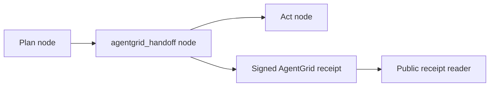

# LangGraph → AgentGrid handoff node

An **unofficial, minimal example** LangGraph node that records a signed
AgentGrid handoff for a decision the graph already made. It does not change
routing, does not approve actions, and does not add an official LangGraph
integration.

## Install

```bash
pip install theoc-agentgrid-protocol
export AGENTGRID_API_KEY=agk_...      # your own key, in your own environment
```

Windows CMD: `set AGENTGRID_API_KEY=agk_...`

## Use in a graph

```python
from agentgrid_protocol import AgentGrid

from agentgrid_handoff import make_agentgrid_handoff_node

ag = AgentGrid()
planner = ag.create_agent("Planner", capabilities=["plan"])
worker = ag.create_agent("Worker", capabilities=["read"])

handoff_node = make_agentgrid_handoff_node(planner=planner, worker=worker)

# In your existing LangGraph build:
# graph.add_node("agentgrid_handoff", handoff_node)
# graph.add_edge("plan", "agentgrid_handoff")
# graph.add_edge("agentgrid_handoff", "act")

result = handoff_node({"task": "summarize the quarterly report"})
print(result["agentgrid_receipt"]["handoff_id"])
```

The node adds `task_hash` and `agentgrid_receipt` to state and leaves other keys
untouched. It checks that the receipt's hash matches the local task text before
returning. Raw task text is not sent to AgentGrid; only the SHA-256 digest is
stored in the receipt.



## Tests

```bash
python -m unittest discover -s tests
```

The tests use fake agents and make no network calls, so no API key is needed.

## Honest notes

- This is a drop-in example, not an official LangGraph integration or a
  claim about LangGraph's own security model.
- A receipt records a signed handoff; it does not prove the work succeeded.
- Nested handoffs must narrow scope; the service rejects widening with HTTP 400.
- No credentials are included in this folder.

See `PR_BODY.md` for a paste-ready pull request description.
